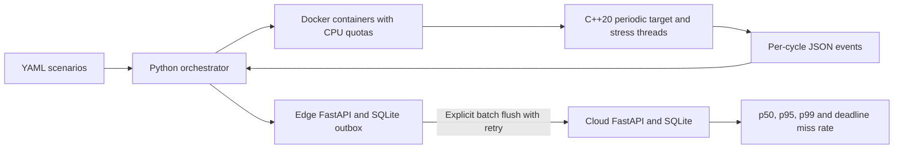

# Edge Test Orchestrator Lab

A synthetic embedded test lab with a C++20 periodic target, a Python 3.11 Docker
orchestrator, a durable FastAPI edge buffer and a FastAPI cloud service with SQLite.
GitHub Actions builds and tests everything. Docker runs on the GitHub runner.
No accounts, keys, software installation or Docker on your PC are needed.

## Architecture



The orchestrator starts unprivileged target containers with `--cpus`, memory and
PID limits, a read only filesystem, no network and all capabilities dropped.
It checks Docker's configured `NanoCpus` value and saves that evidence.
Docker applies the [CPU quota through cgroups](https://docs.docker.com/engine/containers/resource_constraints/).
The service containers use a private Compose network and ports bound to loopback.

## How timing works

The target uses `std::chrono::steady_clock` and absolute `sleep_until` releases.
Release zero is one configured period after the origin. It does not reset the
schedule to the latest wake-up time, so a late cycle cannot hide accumulated delay.
Every cycle records monotonic scheduled and actual start times, in nanoseconds,
and the following measurements in microseconds:

- Wake-up latency: actual start minus scheduled release.
- Signed jitter: interval between actual starts minus configured period.
  The first cycle has zero jitter because there is no prior interval.
- Execution time: finish minus actual start, including preemption during work.
- Deadline miss: finish is strictly later than scheduled release plus one period.

Every observed cycle has a deadline flag. Late cycles catch up against the original
schedule; the target does not skip releases. A killed container has an incomplete
run with its observed samples. Missing cycles are not invented or added to the
deadline miss denominator.

The target attempts Linux `SCHED_FIFO` at priority 10. Without permission it logs
`SCHED_FIFO unavailable` and `using normal SCHED_OTHER scheduling` before measuring.
Containers receive no real-time scheduling capability. The end to end test checks
that the real fallback log is present.

CPU work is a busy arithmetic loop, not a sleeping delay. Stress threads share the
container's CPU quota. JSON is flushed after each sample, outside that cycle's
execution measurement. Logging can still delay later cycles.

## Scenarios and forwarding

`scenarios/lab.yaml` defines a baseline, CPU stress with a lower quota, a slower
configured period, a forced overrun and a killed container. The runner waits for an
observed sample before timing the kill. It saves JSON events, parsed measurements,
actual container exit codes and configured quotas. Containers are removed in cleanup.

The edge accepts a validated run at `POST /measurements` and stores it durably.
`POST /flush` forwards up to 50 queued runs. Failure leaves them queued. The cloud
accepts `POST /measurements/batch` in one transaction. Repeating the same run ID and
payload is a duplicate; changing the payload for that ID is a conflict. Only a valid
cloud acknowledgement lets the edge remove its queued batch.

Cloud `GET /summary` returns linearly interpolated latency percentiles across all
observed samples, deadline misses divided by sample count, and incomplete run counts.
`?scenario=baseline` filters the summary. An empty summary has null percentiles and
a zero miss rate. Edge `GET /buffer` reports queued runs. Both services expose `/health`.

## Running on a runner

The push workflow performs the complete setup. These are its main commands after
the runner installs the Python package and has Docker available:

```bash
cmake -S . -B build -DENABLE_COVERAGE=ON && cmake --build build --parallel 2
docker build -f Dockerfile.target -t edge-lab-target:ci . && docker compose up --build --detach --wait
edge-lab scenarios/lab.yaml --out artifacts/targets
```

`edge-lab --buffer-only` defers the flush until the cloud is available.
`python -m orchestrator.cli` offers the same interface.
The C++ job runs Google Test, target process checks, clang-tidy and gcovr.
The Python job runs ruff and pytest with an 85 percent coverage gate.
The C++ line coverage gate is also 85 percent.
The Compose test stops the cloud, runs all five real target containers, restarts the
edge, verifies durable buffering, restarts the cloud and compares the summary with
an independent calculation. It retries every run to check deduplication and restarts
the cloud to check persistence. No timing threshold assumes a real-time runner.

## Measured results

Final test counts and coverage will be copied from completed CI artifacts before delivery.
The workflow uploads Google Test XML, pytest XML, C++ and Python coverage XML,
target JSON logs, service logs, the cloud summary and a combined measurement record.

## Limits

- A shared CI runner and a normal Linux kernel are not a real-time system.
  Latency results vary with host load, throttling, logging and scheduling.
- Docker containers share the host kernel. This is process isolation, not a hardware
  emulator, virtual machine or test on real embedded hardware.
- CPU quotas are verified as Docker configuration. They do not reserve a CPU or
  prove a particular amount of executed CPU time.
- The stress and overrun workloads are synthetic. A stress run is not required to
  have worse percentiles than the baseline on every runner.
- The cloud summarizes wake-up latency. It does not report network latency or
  prove a worst case execution time bound.
- The edge flush is explicit. There is no autonomous background retry, distributed
  transaction, authentication or TLS. This stack is for an isolated lab.
- SQLite holds a small dataset. Summary queries load runs into memory.
- All names, workloads and scenarios are synthetic. There is no real device or client data.
